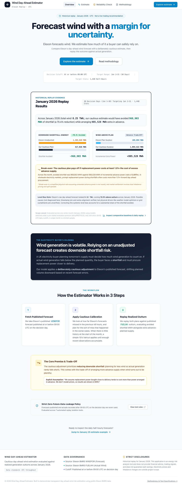
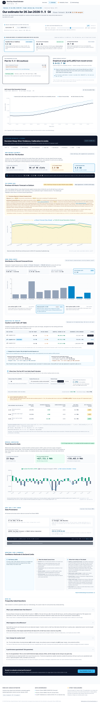
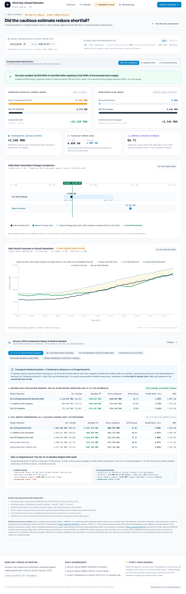
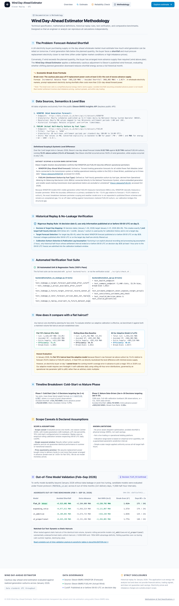

# Wind Day-Ahead Estimator

> **Risk-calibrated day-ahead wind power procurement estimator for Great Britain wholesale electricity markets.**

[](scripts/check.sh)
[](https://python.org)
[](https://fastapi.tiangolo.com)
[](https://vitejs.dev)
[](docker-compose.yml)
[-0284c7?style=flat-square)](https://data.elexon.co.uk)
[](LICENSE)

---

## Overview

In GB wholesale electricity procurement, wind generation forecast errors are financially asymmetric: when realized wind falls below the planned day-ahead volume, the buyer is **short** and must purchase emergency replacement electricity at volatile, often elevated same-day or cash-out prices.

**Wind Day-Ahead Estimator** ingests published Elexon BMRS `WINDFOR` forecasts and applies an empirical, risk-calibrated margin to produce a **safe day-ahead wind estimate (GW)** that protects procurement schedules against over-forecast risks. Outcomes are evaluated against metered national wind outturns (`FUELHH`) to quantify avoided shortfall energy, incremental advance supply, and net procurement benefit.

```
       [ Elexon Central Forecast (WINDFOR) ]
                         │
                         ▼
        [ Strict 09:00 UTC Decision Cutoff ] ── (1h Outturn Publication Lag)
                         │
                         ▼
        [ Calibrated Estimator (flat_15) ] ── Headline Model (+3.24M Net MWh)
                         │
         ┌───────────────┴───────────────┐
         ▼                               ▼
 [ Day-Ahead Estimate (GW) ]    [ Indicative Range ]
 (Physical Delivery Schedule)   (Empirical Error Band)
```

---

## Application Interface

| Overview & Problem Framing | Day-Ahead Estimate (`/jan25`) |
| :---: | :---: |
| <br><sub>Landing view: Shortfall dilemma and workflow</sub> | <br><sub>Estimate view: Safe plan vs Elexon raw forecast with risk slider</sub> |

| Outturn Check (`/jan25/check`) | Methodology & Validation (`/docs`) |
| :---: | :---: |
| <br><sub>Reliability check: Forecast vs actual with shortfall shading</sub> | <br><sub>Methodology documentation: Mathematical proofs and validation records</sub> |

---

## Quick Start

### Option 1: Docker Compose (Production-Ready)

Run the entire containerized stack with a single command:

```bash
docker compose up --build
```

- **Frontend Application (Nginx reverse proxy):** [http://localhost:3000](http://localhost:3000)
- **Backend API:** [http://localhost:8000](http://localhost:8000)
- **Interactive OpenAPI Documentation:** [http://localhost:8000/docs](http://localhost:8000/docs)
- **Health Check:** `curl http://localhost:8000/api/health`

To stop the containers:
```bash
docker compose down
```

---

### Option 2: Native Local Development

#### Prerequisites
- **Python:** 3.9, 3.10, 3.11, or 3.12
- **Node.js:** 18+ and `npm`

#### 1. Backend Setup
```bash
# From repository root:
cd backend
python3 -m pip install -r requirements.txt
python3 -m uvicorn app.main:app --host 127.0.0.1 --port 8001 --reload
```
*API live at `http://127.0.0.1:8001`. Interactive docs at `http://127.0.0.1:8001/docs`.*

#### 2. Frontend Setup
```bash
# In a separate terminal, from repository root:
cd frontend
npm install
npm run dev
```
*Frontend live at `http://localhost:5174` (automatically proxies `/api` to port 8001).*

---

## Production Deployment

The project is architected for zero-configuration containerized deployments on standard cloud platforms.

### Production Environment Variables

| Variable | Target | Default | Description |
| :--- | :--- | :--- | :--- |
| `ENVIRONMENT` | Backend | `development` | Set to `production` in live environments to enforce strict CORS. |
| `PORT` | Backend | `8000` | Port for the Uvicorn ASGI server. |
| `CORS_ORIGINS` | Backend | `http://localhost:3000,http://127.0.0.1:3000` | Comma-separated list of allowed client origins (no wildcards allowed in production). |
| `CACHED_DATASET_PATH` | Backend | `app/data/jan2026.parquet` | Absolute or relative path to the verified replay dataset. |
| `VITE_API_BASE_URL` | Frontend | `""` (relative `/api`) | Override if the frontend is hosted on a separate domain from the backend API. |

---

### Platform Blueprints

#### Docker Host / VPS (DigitalOcean, Hetzner, AWS EC2, Coolify, Portainer)
1. Clone the repository and configure `.env` based on `.env.example`.
2. Run `docker compose up -d --build`.
3. Configure your reverse proxy (Caddy, Traefik, Nginx) or DNS to point port 3000 to your public domain with TLS.

#### Render / Railway / Fly.io (Container PaaS)
- **Backend Service:**
  - Build Type: `Dockerfile`
  - Context: `./backend`
  - Port: `8000`
  - Healthcheck Endpoint: `/api/health`
- **Frontend Service:**
  - Build Type: `Dockerfile`
  - Context: `./frontend`
  - Port: `80`
  - Or deploy statically: build command `cd frontend && npm install && npm run build`, publish directory `frontend/dist`. Set `VITE_API_BASE_URL` to the backend URL.

#### Static Frontend Hosting (Vercel / Netlify / Cloudflare Pages)
- Connect repo, set root directory to `frontend`.
- Build command: `npm run build`.
- Output directory: `dist`.
- Set environment variable: `VITE_API_BASE_URL=https://your-backend-api.com`.
- SPA routing fallback is handled by the included [`frontend/vercel.json`](frontend/vercel.json).

---

## Core Methodology & Economics

### 1. Invariant Physical Energy Accounting
For every half-hour settlement period $t$ ($dt = 0.5\text{ h}$, $1\text{ GW} \times 1000 \times 0.5 = 500\text{ MWh}$):

$$\text{Elexon Shortfall} = \max(0, \text{Forecast}_t - \text{Actual}_t) \times 500$$
$$\text{Safe Plan Shortfall} = \max(0, \text{SafePlan}_t - \text{Actual}_t) \times 500$$
$$\text{Avoided Shortfall} = \text{Elexon Shortfall} - \text{Safe Plan Shortfall}$$
$$\text{Incremental Extra Supply} = \text{Safe Surplus} - \text{Elexon Surplus}$$

**Conservation Identity:** At both interval and aggregated daily levels, avoided shortfall and incremental extra supply conserve total volume cut exactly:
$$\text{Avoided Shortfall (MWh)} + \text{Incremental Extra Supply (MWh)} = \text{Total Volume Cut (MWh)}$$

### 2. Economic Procurement Ledger & Break-Even Premium
Given advance day-ahead power price $P_{\text{adv}}$, replacement power ratio $k = P_{\text{rep}} / P_{\text{adv}}$, and surplus recovery fraction $s \in [0, 1]$ (default $s=0.0$, unrecoverable surplus):

$$\text{Net Saving (£)} = \left[ \text{Avoided Shortfall} \times (k - 1) - \text{Incremental Extra} \times (1 - s) \right] \times P_{\text{adv}}$$
$$\text{Break-Even Price Ratio } k^* = 1 + (1 - s) \times \frac{\text{Incremental Extra Supply}}{\text{Avoided Shortfall}}$$

- At $s = 0.0$, $k^* = 1 + \text{Extra} / \text{Avoided}$.
- In January 2026, the true break-even for `flat_15` is **$1.405\times$** (avoided 1,016,662 MWh, extra 411,934 MWh). Caution breaks even when replacement electricity costs at least 40.5% more than day-ahead contracts.
- At $k = 1.0$, the plan loses $-\text{Extra} \times P_{\text{adv}}$, directly illustrating the cost of insurance on days where central forecasts are accurate.

### 3. Out-of-Time Validation Record (Feb–Sep 2026)
To prevent overfitting or post-hoc tuning, models were evaluated across **241 delivery days** (11,568 half-hour intervals) under frozen protocol (`PROTOCOL_v2.md`):

| Model | Total Avoided (MWh) | Extra Supply (MWh) | Break-Even $k^*$ ($s=0$) | Net MWh ($k=2, s=0$) | Days $k^* < 2\times$ | Monthly Win Record |
| :--- | :--- | :--- | :--- | :--- | :--- | :--- |
| **`flat_15` (Headline)** | **4,582,367.6** | **1,343,575.9** | **$1.414\times$** | **+3,238,791.7** | **175 / 241 (72.6%)** | **8 / 8 Months (100%)** |
| `v2_proportional` | 4,213,293.7 | 1,739,786.1 | $1.413\times$ | +2,473,507.6 | 170 / 241 | 0 / 8 Months |
| `expanding_ratio` | 4,374,383.1 | 2,136,547.0 | $1.488\times$ | +2,237,836.1 | 163 / 241 | 0 / 8 Months |
| `v1_additive` | 3,893,027.7 | 2,485,394.3 | $1.638\times$ | +1,407,633.4 | 146 / 241 | 0 / 8 Months |

*`flat_15` is confirmed as the durable headline model. Dynamic rolling-quantile models timed the market poorly during summer calm regimes, underperforming simple uniform haircuts of matched volume.*

### 4. Empirical Band Disclosure
The indicative $[p10, p90]$ range is an **empirical historical error range, not a calibrated probability interval**. Across January 2026, realised coverage is 55.8% (ranging from 0% on weather regime shifts to 100% on steady wind days). Across Feb–Sep 2026 validation, realised coverage is 62.5%.

---

## API Reference

All endpoints return JSON and adhere to standard HTTP status codes.

| Method | Endpoint | Query Parameters | Description |
| :--- | :--- | :--- | :--- |
| `GET` | `/api/health` | None | Returns backend status, dataset record counts, and date coverage. |
| `GET` | `/api/estimate` | `date` (YYYY-MM-DD), `percentile` (60–90) | Day-ahead safe estimate, empirical band, slider trade-offs, and file provenance. |
| `GET` | `/api/check` | `date` (YYYY-MM-DD), `percentile` (60–90) | Replays decision against realized FUELHH actuals; reports avoided MWh, extra MWh, and MAE. |
| `GET` | `/api/summary` | None | Replay summary across all models and baseline comparators for January 2026. |
| `GET` | `/api/validation`| None | Out-of-time validation metrics across Feb–Sep 2026 from generated summary. |

### Example Request & Response
```bash
curl -s "http://localhost:8000/api/estimate?date=2026-01-25&percentile=75"
```
```json
{
  "decision_date": "2026-01-25",
  "target_date": "2026-01-26",
  "decision_cutoff_utc": "2026-01-25T09:00:00Z",
  "selected_percentile": 75.0,
  "elexon_headline_gw": 12.4207,
  "safe_headline_gw": 9.8972,
  "provenance": {
    "snapshot_filename": "jan2026.parquet",
    "snapshot_size_kb": 253,
    "snapshot_sha256": "d997afe42e53663a4dbef2c597da8f515d5490d7fbb159370b28fbb5c9a95f98",
    "snapshot_record_count": 37696,
    "snapshot_status": "Replay cache"
  }
}
```

---

## Verification & Automated Test Suite

A single command executes the complete multi-layer verification suite:

```bash
bash scripts/check.sh
```

### Verification Layers
1. **Dataset Integrity Audit:** Asserts schema, UTC timestamps, 1,488 actual intervals (31/31 days with 48/48 intervals), 36,208 forecast rows, and SHA-256 immutability pin.
2. **Audit Checks Baseline:** Runs `scripts/audit_checks.py` to confirm exact reproduction of empirical audit findings.
3. **30-Date Endpoint Sweep:** Verifies HTTP 200 OK and absence of NaN/null values across all 30 dates in January 2026 for `/api/estimate` and `/api/check`.
4. **Backend Test Suite (59 Tests):**
   - 7 distinct release-blocking zero-future-data-leakage scenario tests.
   - Independent 4-interval oracle tests and volume conservation checks.
   - Mathematical property invariant tests (monotonicity, conservation, non-negativity, linearity).
   - 2,000-draw day-block bootstrap uncertainty quantification.
   - Empirical band realised coverage tests (55.8% Jan, 62.5% validation).
   - Automated claims & terminology lint test (`test_claims_lint.py`).
   - Frontend literal fallback and provenance honesty test (`test_no_frontend_literals.py`).
   - Physical procurement ledger identity tests.
5. **Frontend TypeScript Check:** `tsc --noEmit` validates all components and contracts.
6. **Production Build:** Vite production bundle with route-based code-splitting (all chunks < 500 kB).

---

## Repository Structure

```
fuelhh/
├── backend/
│   ├── app/
│   │   ├── main.py                  # FastAPI application entry point
│   │   ├── config.py                # System settings and CORS validation
│   │   ├── schemas.py               # Pydantic API response contracts
│   │   ├── routers/                 # Endpoints: estimate, check, summary, health, validation
│   │   ├── services/                # Core engines: replay, economics, calibrate, models, stats
│   │   └── data/                    # Verified Parquet datasets and validation artefacts
│   ├── tests/                       # 59 automated tests (oracles, leakage, properties, lint)
│   ├── Dockerfile                   # Python 3.12 production container definition
│   └── requirements.txt             # Pinned backend dependencies
├── frontend/
│   ├── src/
│   │   ├── pages/                   # LandingPage, EstimatePage, CheckPage, DocsPage
│   │   ├── components/              # DeepDive, CostRatioCalculator, Charts, Navbar, Footer
│   │   └── types/                   # TypeScript interfaces
│   ├── Dockerfile                   # Multi-stage Node builder + Nginx production server
│   ├── nginx.conf                   # Reverse proxy configuration for /api/
│   └── package.json                 # Pinned frontend dependencies
├── docs/
│   ├── PROTOCOL_v2.md               # Frozen out-of-time validation protocol
│   ├── VALIDATION.md                # Generated 8-month validation report
│   ├── CLAIMS_AUDIT.md              # Calibrated language specification
│   └── screenshots/                 # Application screenshots (desktop & mobile)
├── scripts/
│   ├── check.sh                     # Complete single-command verification suite
│   ├── sweep_test.py                # 30-date automated endpoint sweep
│   ├── audit_checks.py              # Baseline audit replication script
│   └── capture_screenshots.py       # Playwright screenshot generator
├── docker-compose.yml               # Production multi-service orchestration
└── README.md                        # Project documentation
```

---

## License & Data Citations

- **Software:** Distributed under the [MIT License](LICENSE).
- **Energy Data:** Contains public sector information licensed under the Open Government Licence v3.0, sourced from [Elexon BMRS](https://bmrs.elexon.co.uk) (`WINDFOR` Day-Ahead Wind Forecasts and `FUELHH` Half-Hourly Outturn Generation).
- **Disclaimer:** This software is an analysis and risk-estimation tool for wholesale power planning. It does not constitute real-time operational dispatch instructions or trading advice.
