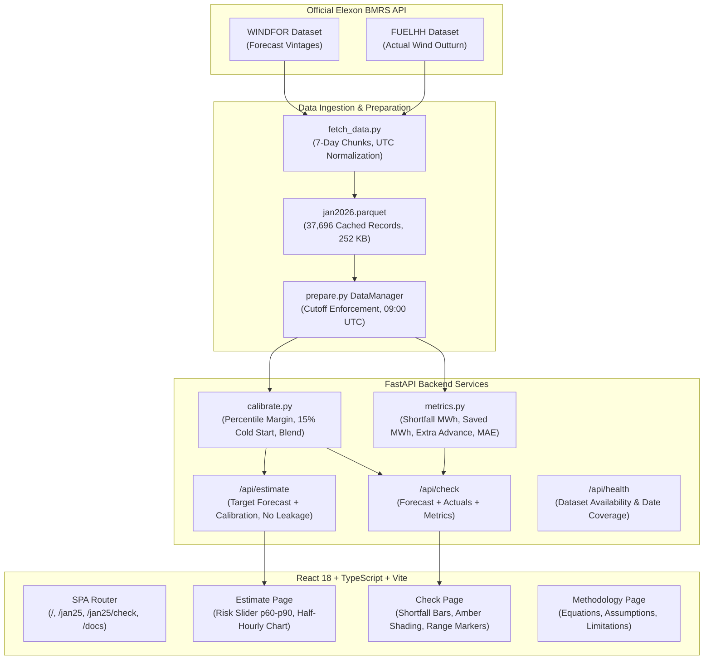

# Wind Day-Ahead Estimator

> *“Elexon forecasts wind. We estimate how much of it a buyer can safely rely on.”*

[-0284c7)](https://data.elexon.co.uk)
[](https://fastapi.tiangolo.com)
[](https://vitejs.dev)
[-success)](scripts/check.sh)

A complete, deployable MVP that applies a deliberately cautious adjustment to Elexon's day-ahead wind generation forecast and replays the outcome against actual generation to evaluate avoided shortfall energy across January 2026.

---

## Table of Contents

1. [Product Overview](#product-overview)
2. [Problem Statement](#problem-statement)
3. [User Journey & Interface](#user-journey--interface)
4. [System Architecture](#system-architecture)
5. [Data Sources & Provenance](#data-sources--provenance)
6. [Historical Replay & No-Leakage Rules](#historical-replay--no-leakage-rules)
7. [Estimation Methodology](#estimation-methodology)
8. [Reliability & Evaluation Metrics](#reliability--evaluation-metrics)
9. [Local Development & Setup](#local-development--setup)
10. [Automated Verification & Testing](#automated-verification--testing)
11. [Docker & Deployment](#docker--deployment)
12. [Assumptions & Known Limitations](#assumptions--known-limitations)
13. [Future Scope](#future-scope)

---

## Product Overview

A UK electricity buyer planning tomorrow's wholesale power procurement must decide how much intermittent wind generation to count on. If actual wind generation falls below the planned quantity, the buyer faces a **shortfall** and must procure emergency replacement electricity closer to real-time. If wind exceeds the planned quantity, the buyer has arranged more advance supply than required.

**Wind Day-Ahead Estimator** takes Elexon's published wind forecast and applies a deterministic, data-driven margin based on recent historical errors and a 15% cold-start haircut rule. The product provides:
- A safe day-ahead wind generation estimate in **GW**.
- An indicative empirical uncertainty band (10th to 90th percentiles).
- An interactive risk slider ($p60$ to $p90$) to tune buyer conservatism.
- A full historical replay against realized generation outturns across all 30 decision dates in January 2026.
- Transparent reporting of avoided shortfall energy (MWh), additional advance wind (MWh), and Mean Absolute Error (GW).

---

## Problem Statement

When procurement teams rely solely on unadjusted central forecasts:
1. **Forecast errors are asymmetrical in financial impact:** A shortfall often carries severe price spikes in the balancing mechanism or intraday market, whereas surplus wind can typically be spilled or curtailed.
2. **Buyers lack transparent risk controls:** Most off-the-shelf forecasts provide a single $P_{50}$ point estimate without showing the empirical downside distribution or lookback calibration coverage.
3. **Black-box models leak future information:** Traditional demos often contaminate calibration with data from after the decision cutoff or substitute subsequent revisions for historical forecasts.

This MVP demonstrates a transparent, reproducible, leak-free solution using real historical Elexon data.

---

## User Journey & Interface

The application comprises four integrated pages:

1. **Overview / Landing Page (`/`):** Explains the buyer's shortfall dilemma, the 3-step workflow, and the fundamental trade-off between avoided shortfall and extra advance supply.
2. **Estimate Page (`/jan25`):** Displays tomorrow's raw Elexon forecast alongside our safe estimate and indicative band for any decision date in January 2026, with an interactive risk slider and calibration coverage badge. Strictly no target-day actuals are visible.
3. **Reliability Check Page (`/jan25/check`):** Replays the decision against actual realized generation (`FUELHH`), presenting range comparisons, half-hourly forecast-versus-actual charts with amber shortfall highlights, shortfall comparison bars, avoided shortfall energy, and MAE.
4. **Methodology Documentation (`/docs`):** Details equations, data pipelines, timestamp semantics, and assumptions so an external analyst can reproduce every calculation.

### Interface Screenshots

<!-- Screenshot Placeholders -->
| Overview Page | Estimate Page |
| :---: | :---: |
| <br>*Landing page: Problem definition and 3-step workflow* | <br>*Estimate page: Our safe estimate vs Elexon raw forecast with risk slider* |

| Reliability Check Page | Methodology Page |
| :---: | :---: |
| <br>*Check page: Forecast vs actual with shortfall shading and saved MWh* | <br>*Documentation: Mathematical definitions and replay rules* |

*(Note: Replace image paths above with exported screenshots when deploying to production)*

---

## System Architecture



---

## Data Sources & Provenance

Data is ingested from the official **Elexon Insights Solution / BMRS API**:

| Series | BMRS Dataset Code | Source Endpoint | Granularity | Units | Role in Application |
| :--- | :--- | :--- | :--- | :--- | :--- |
| **Wind Forecast** | `WINDFOR` | `/bmrs/api/v1/datasets/WINDFOR` | Hourly schedules (mapped to 2 SPs) | MW $\rightarrow$ GW | Day-ahead generation forecast |
| **Actual Wind** | `FUELHH` | `/bmrs/api/v1/datasets/FUELHH` (`fuelType=WIND`) | Half-hourly (48 SPs / day) | MW $\rightarrow$ GW | Target outcome & historical calibration |

### Unit Normalization
- **Power (UI & Headlines):** Gigawatts (GW). Formula: $\text{GW} = \text{MW} / 1000.0$.
- **Energy (Shortfall & Metrics):** Megawatt-hours (MWh). Formula: $\text{MWh} = \text{GW} \times 1000.0 \times 0.5\text{ hours} = \text{MW} \times 0.5$.
- **Timestamps:** Timezone-aware UTC throughout. Each half-hour interval is keyed by its canonical interval start timestamp (e.g. `2026-01-15T00:00:00Z`).

---

## Historical Replay & No-Leakage Rules

For a decision made on date $D$ for target delivery date $D+1$:
1. **Decision Cutoff:** Fixed at **09:00:00 UTC** on date $D$.
2. **Forecast Selection:** Selects the latest forecast vintage published strictly at or before $D$ at 09:00 UTC covering intervals of target date $D+1$. Forecasts published at 09:30, 11:30, or 15:30 UTC on day $D$ are strictly ignored.
3. **Historical Calibration Selection:** Calibration uses only intervals where both the day-ahead forecast and actual generation were published at or before $D$ at 09:00 UTC.
4. **No Future Leakage Guarantee:** The `/api/estimate` endpoint never queries, contains, or passes target-day actual observations or actual-derived statistics. Verified by automated tests.

---

## Estimation Methodology

### 1. Signed Forecast Error
For each historical half-hourly interval $t$ in the lookback window:
$$\text{error}_t = \text{forecast}_t - \text{actual}_t$$
- $\text{error}_t > 0$: Forecast was higher than actual (over-forecast; shortfall risk).
- $\text{error}_t < 0$: Actual wind was higher than forecast.

### 2. Data-Driven Margin
For a user-selected risk percentile $p \in [60, 90]$ (default 75):
$$\text{data\_margin} = \max\left(0, \text{Percentile}(\{\text{error}_t\}, p)\right)$$
*Zero Flooring:* If the empirical percentile error is negative, the margin is floored at 0 so the model never increases planned wind beyond Elexon's forecast.

### 3. Cold Start & Linear Blending
- **Cold-Start Haircut:** $15\%$ of raw forecast ($\text{cold\_margin} = \max(0, \text{raw\_forecast}) \times 0.15$).
- **History Weight:** For $n$ valid calibration observations in the 48-hour lookback:
  $$\text{weight} = \min\left(1.0, \frac{n}{96}\right)$$
- **Blended Margin:**
  $$\text{applied\_margin} = (1 - \text{weight}) \times \text{cold\_margin} + \text{weight} \times \text{data\_margin}$$
- **Safe Estimate:**
  $$\text{safe\_estimate\_GW} = \max(0, \text{raw\_forecast\_GW} - \text{applied\_margin})$$

### 4. Calibration Confidence Labels
- **Low:** $n < 24$ observations (pure cold-start or early Jan; heavy 15% haircut).
- **Medium:** $24 \le n \le 95$ observations (linear history blend).
- **High:** $n = 96$ observations (100% empirical data margin).

### 5. Indicative Error Band
- Lower Bound: $\max(0, \text{raw\_forecast} - \text{applied\_quantile}_{90})$
- Upper Bound: $\max(\text{lower\_bound}, \text{raw\_forecast} - \text{applied\_quantile}_{10})$

---

## Reliability & Evaluation Metrics

For interval duration $dt = 0.5$ hours:

### 1. Shortfall Energy (MWh)
$$\text{shortfall\_MWh} = \sum_{t=1}^{48} \max(0, \text{Planned}_{t,\text{GW}} - \text{Actual}_{t,\text{GW}}) \times 1000 \times dt$$
Calculated independently for Elexon raw forecast and our safe estimate.

### 2. Avoided Shortfall Energy (MWh)
$$\text{saved\_MWh} = \text{elexon\_shortfall\_MWh} - \text{our\_shortfall\_MWh}$$
*Honesty Guarantee:* Negative values (when our estimate underperforms) are preserved and displayed transparently.

### 3. Additional Advance-Planned Wind (MWh)
$$\text{extra\_advance\_MWh} = \sum_{t=1}^{48} \max(0, \text{Actual}_{t,\text{GW}} - \text{Safe\_Estimate}_{t,\text{GW}}) \times 1000 \times dt$$
Represents actual wind above our planned estimate (cost-side trade-off).

### 4. Mean Absolute Error (MAE in GW)
$$\text{MAE} = \frac{1}{48} \sum_{t=1}^{48} |\text{Prediction}_{t,\text{GW}} - \text{Actual}_{t,\text{GW}}|$$

### 5. Empirical Range Coverage
Fraction of actual half-hourly points falling within the indicative $[p10, p90]$ band on the target day.

---

## Local Development & Setup

### Prerequisites
- Python 3.9+
- Node.js 18+ and npm

### 1. Clone & Set Up Backend
```bash
# Navigate to backend
cd backend

# Install dependencies
pip install -r requirements.txt

# (Optional) Re-fetch fresh Elexon data or validate existing parquet
python scripts/validate_data.py
```

### 2. Start Backend Server
```bash
# From workspace root
uvicorn backend.app.main:app --reload --port 8000
```
Backend will be live at `http://localhost:8000`. OpenAPI docs available at `http://localhost:8000/docs`.

### 3. Start Frontend
```bash
# In a new terminal
cd frontend
npm install
npm run dev
```
Frontend will be live at `http://localhost:5173`.

---

## Automated Verification & Testing

Run the complete, single-command automated test and verification suite:

```bash
./scripts/check.sh
```

This runs:
1. **Dataset Integrity Audit:** Checks schema, UTC timestamps, 1,488 actual intervals, 36,208 forecast intervals, unit conversions, and 100% 48/48 coverage across all 30 days.
2. **Backend Unit & Integration Tests (29 tests):**
   - Data preparation & UTC alignment
   - Calibration boundaries & percentiles
   - Zero-margin flooring & cold-start blend
   - Release-blocking no-leakage verification (5 distinct leakage attack scenarios)
   - Reliability metrics (shortfall MWh factor 500, extra advance, MAE)
   - API contract consistency and isolation
3. **Frontend TypeScript Check:** `tsc --noEmit`
4. **Frontend Production Build:** `vite build`

---

## Docker & Deployment

### Run Backend via Docker
```bash
# Build Docker image
docker build -t wind-day-ahead-backend -f backend/Dockerfile backend

# Run container
docker run -p 8000:8000 wind-day-ahead-backend
```

### Deploy to Hosting Platforms
- **Backend:** Suitable for Render, Railway, Fly.io, or AWS ECS using `backend/Dockerfile` or `uvicorn app.main:app --host 0.0.0.0 --port 8000`. Set `CORS_ORIGINS` in environment.
- **Frontend:** Suitable for Vercel or Netlify. Set `VITE_API_BASE_URL` to your backend URL. The included `frontend/vercel.json` ensures SPA route fallback for `/jan25`, `/jan25/check`, and `/docs`.

---

## Assumptions & Known Limitations

1. **Assumptions:**
   - 09:00 UTC day-ahead cutoff is standard operating market cutoff assumption.
   - Fixed 15% cold-start haircut rule when prior history is zero.
   - Hourly WINDFOR forecast applies uniformly across both constituent 30-minute settlement periods.
2. **Limitations:**
   - The product models physical energy shortfall (MWh); it does not calculate financial cash savings or incorporate electricity market prices.
   - Not a live trading or operational dispatch recommendation.
   - The error band is an empirical quantile band, not a calibrated probabilistic prediction interval.

---

## Future Scope

- Expanding lookback beyond 48 hours with seasonal weather-regime clustering.
- Imbalance price-aware optimization balancing penalty costs against day-ahead contract premiums.
- Diurnal per-hour calibration accounting for morning/evening wind patterns.
- Automated streaming ingestion from Elexon BMRS for live operational forecasting.

---

## License

Built for demonstration, verification, and technical auditing purposes.
All source energy data © Elexon BMRS.
